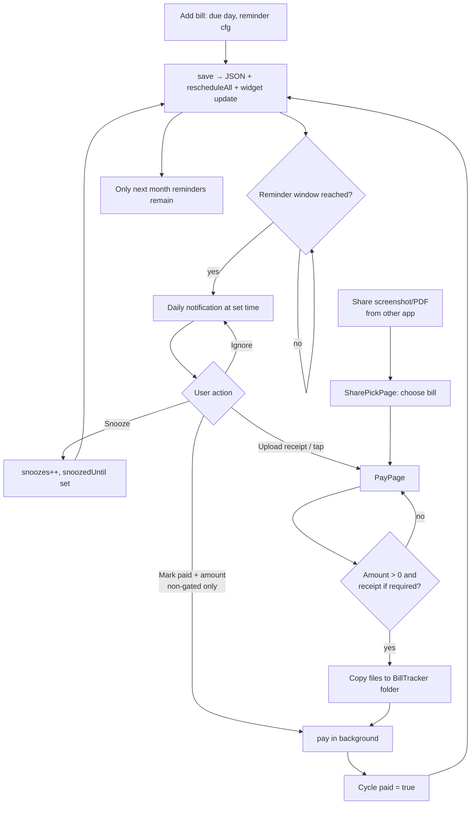

# Bill Tracker: App Analysis

An analysis of the source in this folder: what the app is for, what it needs to run, what each feature does, how data moves through it, and one complete use case from start to finish.

---

## 1. Purpose

Bill Tracker is a **personal, offline Android app** (Flutter) for people who pay many recurring bills (credit cards, electricity, water, broadband and so on) through **different payment apps** such as CRED, Paytm, PhonePe, Google Pay or a bank app.

The problem it solves: each payment app only knows about the payments made inside it, so nothing gives one view of "what is due, what is paid, and where is the proof". Bill Tracker:

1. Keeps one list of every recurring bill with its monthly due date.
2. **Keeps reminding you every day** from N days before the due date until that month is marked paid.
3. Can be set to **"receipt-gated"**: reminders stop only after a payment screenshot or PDF is attached as proof.
4. Stores receipts and statements as plain files in a `BillTracker` folder on the phone.
5. Shows spending insights (monthly totals, share per bill, card utilization, which apps were used).

There is no server, no account and no network use. All data stays on the phone, with zip backups that you can share to Google Drive by hand.

---

## 2. Requirements

### 2.1 Platform and build

| Item | Value |
|---|---|
| Framework | Flutter, Dart SDK `^3.5.0` |
| Target | Android only (`flutter create --platforms android`) |
| Package / applicationId | `com.deven.billtracker` |
| minSdk | 24 (Android 7.0) |
| Java | 17, with core library desugaring (`desugar_jdk_libs 2.1.4`) |
| Main activity | `FlutterFragmentActivity` (needed by `local_auth` for fingerprint) |
| Setup | `setup.sh` generates the Android project, copies `android_overlay/` over it, patches `build.gradle.kts`, makes icons, and runs analyze and test |

### 2.2 Dependencies (`pubspec.yaml`)

| Package | Used for |
|---|---|
| `path_provider` | App documents, external and temp directories |
| `permission_handler` | "All files access" (`MANAGE_EXTERNAL_STORAGE`) |
| `flutter_local_notifications`, `timezone` | Scheduled reminders with action buttons |
| `file_picker` | Picking receipt, statement or backup files |
| `open_filex` | Opening a saved receipt or PDF in another app |
| `fl_chart` | Pie and bar charts in Insights |
| `receive_sharing_intent` | Receiving a screenshot or PDF shared from another app |
| `home_widget` | Two Android home-screen widgets |
| `local_auth`, `flutter_secure_storage` | Fingerprint unlock and PIN storage |
| `archive` | Zip backup and restore |
| `share_plus` | Sharing a backup or CSV (for example to Drive) |

### 2.3 Android permissions (`AndroidManifest.xml`)

- `POST_NOTIFICATIONS`, `SCHEDULE_EXACT_ALARM`, `RECEIVE_BOOT_COMPLETED`, `VIBRATE`: reminders, including after a reboot
- `USE_BIOMETRIC`: fingerprint unlock
- `MANAGE_EXTERNAL_STORAGE`, plus legacy `READ_`/`WRITE_EXTERNAL_STORAGE`: saving to `/storage/emulated/0/BillTracker`
- Intent filters `ACTION_SEND` for `image/*` and `application/pdf`: "Share to Bill Tracker"
- Two `AppWidgetProvider` receivers: `BillListWidget` and `BillCountWidget`

### 2.4 Functional requirements (as implemented)

| ID | Requirement |
|---|---|
| FR-1 | The user can add, edit and delete a bill of category **Credit card** or **Utility**. |
| FR-2 | Each bill repeats monthly on a fixed due day. Day 29–31 is clamped to the last day of shorter months. |
| FR-3 | A card can store a statement day and a credit limit. |
| FR-4 | Each bill has its own reminder settings: on/off, days before, time of day, snooze length, maximum snoozes, and "require receipt". |
| FR-5 | Reminders fire daily from `due − before` days until the month is paid, for every unpaid month from 3 months back to next month. At most one reminder per bill per day, for the oldest unpaid month ("+N more unpaid months" in the text). They are planned 40 days ahead and re-planned daily by a background job. |
| FR-6 | A notification offers **Snooze** and either **Upload receipt** (receipt-gated) or **Mark paid** with an inline amount input. |
| FR-7 | A payment records amount, paid-on date, paid-via app, an optional (or required) receipt and an optional statement. |
| FR-8 | When reminders are on and receipt-gated, a payment cannot be saved without a receipt. |
| FR-9 | Files shared from other apps open a "Which bill is this for?" picker, which leads into the payment form. |
| FR-10 | Files are copied to `BillTracker/Receipts/<bill>/` or `BillTracker/Statements/<bill>/`, named `<yyyy-mm>_<name>.<ext>`. |
| FR-11 | Payment history per bill: months paid, total, average, late-payment days, open or attach files, remove a payment. |
| FR-12 | Insights over 1, 3, 6 or 12 months: total, monthly average, highest month, share by bill, stacked monthly bars (card vs utility), card utilization against a 30% mark, and totals per payment app. |
| FR-13 | Optional app lock with a 4-digit PIN and fingerprint, and a "lock after" delay of 0, 1, 5 or 15 minutes. |
| FR-14 | Manual and automatic (daily, weekly or monthly) zip backup with an optional receipts/statements bundle. Keeps the 5 newest. |
| FR-15 | CSV export of all paid months. Restore from a backup zip (this phone's lock and backup settings are kept). |
| FR-16 | Two home-screen widgets: the next 3 bills, and the count due within 7 days plus the overdue count. |

### 2.5 Non-functional characteristics

- **Offline and private.** No network calls. Data is a single JSON file in the app documents dir (`billtracker.json`).
- **Safe writes.** Data is written to `.tmp` and then renamed, so the file is replaced in one step.
- **Locale.** Indian number format (`₹1,78,287`, `₹1.5L`). The timezone prefers `Asia/Kolkata` when the device offset matches it.
- **Testability.** Date and cycle logic is kept in `logic.dart` with no Flutter imports, and is unit tested in `test/`, along with the pure `paths.dart` (safe restore) and `pin_policy.dart` (PIN hashing and lockout).
- **Theming.** Material 3 light and dark themes with a green accent (`#0E6B57`).

---

## 3. Architecture

```
lib/
├── main.dart            App start, lifecycle, share-intent and notification routing
├── models.dart          FileRef, Cycle, ReminderCfg, Bill, AppSettings, AppData (JSON)
├── logic.dart           Pure rules: month keys, due dates, active cycle, reminder state, money format
├── store.dart           AppStore singleton (ChangeNotifier): load/save JSON, file copies, bill actions
├── notifications.dart   Scheduling, action buttons, background handler
├── widget_sync.dart     Pushes data to the two home widgets
├── backup.dart          Zip backup, CSV, restore, auto-backup
└── ui/
    ├── nav.dart              Global navigator key + open* helpers
    ├── tabs.dart             Shell (bottom nav) + Home, Bills, Reminders tabs
    ├── bill_form_page.dart   Add / edit bill
    ├── bill_detail_page.dart Bill details, history, payment bottom sheet
    ├── pay_page.dart         "Mark paid" form
    ├── share_pick_page.dart  Pick a bill for a shared file
    ├── insights_page.dart    Charts
    ├── settings_page.dart    Lock, notifications, storage, backup
    ├── lock.dart             LockService, LockGate overlay, PIN pad
    ├── files.dart            File picking, opening, thumbnails
    └── common.dart           Theme, colours, shared widgets
android_overlay/          Manifest, MainActivity, widget providers and layouts (copied by setup.sh)
```

**State pattern.** `AppStore.I` is a single `ChangeNotifier`. Every screen wraps itself in `ListenableBuilder(listenable: AppStore.I)`. Every mutation calls `save()`, which:

1. writes the JSON file,
2. calls `notifyListeners()` so the UI refreshes,
3. runs `onChanged`, which runs `Notifs.rescheduleAll()` and then `WidgetSync.update()`.

So **any change re-plans every reminder and refreshes the widgets**.

---

## 4. Data model

```
AppData
├── nextNid            int (source of numeric ids for notifications)
├── settings: AppSettings { lockOn, lockAfter, autoBackup, backupFreq, backupFiles, lastBackup }
└── bills: [Bill]
     ├── id, nid, category ('card' | 'utility'), name, desc
     ├── dueDay, stmtDay?, limit?, via (usual app)
     ├── startKey   'yyyy-mm' of the first bill
     ├── rem: ReminderCfg { on, before, time 'HH:mm', snooze (min), maxSnooze, requireReceipt }
     └── cycles: { 'yyyy-mm' → Cycle }
           Cycle { paid, amount, paidOn, via, receipt?, statement?, snoozes, snoozedUntil, dismissed }
```

A **cycle** is one bill-month. A cycle exists in the map only after something happens to it (a payment, snooze, dismiss or attachment). `getC()` returns an empty unpaid cycle when it is missing.

### 4.1 Core rules (`logic.dart`)

**Due date.** `dueFor(bill, month)` gives `dueDay` in that month, clamped to the month's length.

**Active cycle**, the month that needs attention:
1. the **oldest** unpaid month from 3 months back (`lookbackMonths`) up to this month, counting only months on or after `startKey`; otherwise
2. next month (or `startKey`, if that is still in the future).

Months older than 3 months are not checked. Editing the due date moves `startKey` to the picked month, but never past a paid month (`newStartKey`).

**Due state** of that cycle:

| State | Condition |
|---|---|
| `overdue` | days to due < 0 |
| `today` | days to due = 0 |
| `soon` | 0 < days ≤ `rem.before` (3 when reminders are off) |
| `upcoming` | later than that |

**Reminder state** (Reminders tab):

| State | Condition |
|---|---|
| `off` | reminders disabled for the bill |
| `scheduled` | the reminder window has not started yet |
| `stopped` | user chose "Stop for <month>" (only for bills without a receipt requirement) |
| `snoozed` | `snoozedUntil` is in the future |
| `active` | in the window and not paid, snoozed or stopped |

---

## 5. Features by screen

### 5.1 Home tab
- Stat tiles: **Overdue**, **Due in 7 days**, **Paid X/Y this month**.
- A "Paid in another app?" card with a **Pick** button, the same flow as sharing a file into the app.
- Sections: *Already due & due soon*, *Upcoming* (shows the date reminders start), *Paid this month* (amount, app, date, and the section total).
- When there are no bills, a welcome screen with **Add bill**.

### 5.2 Bills tab
- Filter chips: All / Credit cards / Utilities, with counts. The list is sorted by next due date.

### 5.3 Add / Edit bill
- Category toggle, name (required), description, **first due date** (only the day-of-month is kept; the month becomes `startKey`), statement day (1–31, cards only), credit limit (cards only), and "usually paid via" with autocomplete from known apps.
- Reminder card: on/off, start N days before (0–25), daily time, snooze length (15 min to 1 day), max snoozes (0–10), and "stop only after receipt upload".
- On save, notification and exact-alarm permissions are requested if reminders are on.

### 5.4 Bill details
- Header with the current state, and either **Upload receipt & mark paid** or "Next bill: …".
- Settings summary (due day, statement, limit, via, reminder, snooze, stop rule).
- Payment history: months paid / months since start, total, average; the last 6 months, expandable to 120.
  - Unpaid month: "Not marked paid" (red when past due) and a **Mark paid** button.
  - Paid month: receipt thumbnail, amount, date, app, "Nd late" tag, and Receipt/Statement tags. Tapping it opens a **payment sheet** with the details, Open or Attach for each file, and **Remove payment**, which sets the month back to unpaid so reminders start again.
- Edit and Delete. The delete dialog has an optional checkbox to also delete the bill's receipt and statement files.

### 5.5 Mark paid (PayPage)
- Amount (hint: "Last time ₹X"), paid-on date (up to today), paid via (autocomplete), receipt and statement drop zones (image or PDF).
- Validation: the amount must be more than 0; a receipt is required when `rem.on && rem.requireReceipt`.
- Saving copies the files into the BillTracker folder, writes the cycle as paid, and clears any snooze or dismiss on it.

### 5.6 Reminders tab
- *Showing now* cards: **Upload receipt / Mark paid**, **Snooze** (with snoozes left), and **Stop for <month>** (only when no receipt is required).
- *Snoozed*, *Scheduled* (start date and time), and *Off or stopped this month*.
- The bottom-nav badge shows the number of active reminders.

### 5.7 Insights
- Period: Month / 3M / 6M / 1Y.
- Tiles: total paid, average per month (over months that had spending), highest month.
- Donut "Where the money went": top 5 bills plus "N other bills".
- Stacked bar chart, credit cards vs utilities, at least 6 months shown. Tapping a bar shows that month's breakdown and its 3 biggest bills.
- Card utilization: the latest paid bill in the last 3 months divided by the limit. Above 30% is *Over-used*, below 10% is *Under-used*, otherwise *Healthy*.
- Paid via: amount and count per app.

### 5.8 Settings
- **App lock**: turn on (set PIN), turn off (verify PIN), lock-after delay, Lock now, Change PIN.
- **Reminder notifications**: send a test reminder (the most urgent active one).
- **Home-screen widget**: instructions.
- **Storage**: shows the folder, and a button to grant "All files access".
- **Backup & export**: auto-backup toggle and frequency, include files, **Back up now and share** (Drive), **Export CSV**, and **Restore** (with a confirmation).

### 5.9 Notifications (outside the app)
- Channel `bill_reminders` (high importance). Titles look like *"HDFC Regalia is due in 3 days" / "…is due today" / "…is 2 days overdue"*.
- Action buttons:
  - **Snooze <interval>** runs in the background, without opening the app. When no snoozes are left, a "No snoozes left" notification is shown.
  - **Upload receipt** opens the app on the Mark paid page.
  - **Mark paid** has an inline amount field and saves in the background with today's date and the bill's usual app. It then shows a "marked paid" confirmation. An invalid amount shows "Payment not saved".
- Tapping the notification body opens Mark paid, or Bill details if the month is already paid.
- Planning is done by the pure `planReminders()` in `logic.dart`. It gives each bill at most one reminder a day, for its oldest unpaid month (the text adds "+N more unpaid months"), covers the next 40 days, and is re-run on every save, at app start, and once a day by a WorkManager job (`lib/background.dart`), which also refreshes the widgets and runs the auto-backup.
- Notification id scheme: `nid*10000 + slot*100 + dayIndex` for daily reminders, `nid*10000 + 9000 + slot` for snooze wake-ups, and `nid*10000 + 9990–9998` for test and info messages. At most 400 are scheduled, keeping the earliest.

### 5.10 Home-screen widgets
- **Bills due next**: up to 3 bills with "Due 8 Nov" or a red "Overdue · 3 Nov", and an "as of" date.
- **Bills this week**: the count due between today and 7 days from now (overdue bills are not included), and "N overdue" or "none overdue".
- Tapping either widget opens the app.

---

## 6. Functional flow: main use case

### Use case UC-1: "Pay a credit card bill in CRED and stop the reminders with proof"

| | |
|---|---|
| **Actor** | Phone owner |
| **Goal** | Never miss a card due date, and keep proof of every payment in one place |
| **Pre-conditions** | App installed, notifications and exact alarms allowed, battery set to *Unrestricted* |
| **Trigger** | The due date approaches |

#### Main success scenario

1. **Add the bill (one time).** The user taps **+**, picks *Credit card*, enters "HDFC Regalia", first due date **8 Nov 2026**, statement day 18, limit ₹3,00,000, usually paid via *CRED*. Reminders: 5 days before at 09:00, snooze 1 hr × 3, *require receipt* ✔.
   - The app saves the bill with `startKey = 2026-11`, `nid = n`, and requests notification and exact-alarm permission.
   - `save()` triggers `rescheduleAll()`, which schedules daily 09:00 notifications from **3 Nov**, 40 days ahead at a time, until November is paid. The widgets refresh.
2. **Reminder fires.** On 3 Nov at 09:00 the phone shows *"HDFC Regalia is due in 5 days. November bill, due 8 Nov. Upload the receipt to stop this reminder."* with **Snooze 1 hr** and **Upload receipt**.
3. **User snoozes (optional).** Tapping **Snooze 1 hr** runs in the background: `snoozes = 1`, `snoozedUntil = now + 60 min`. The app reschedules everything, adds a one-off wake-up at the snooze time, and skips daily slots before it.
4. **User pays in CRED.** This happens outside Bill Tracker. CRED shows a success screen and the user takes a screenshot.
5. **Share the proof.** From the gallery or CRED, the user shares the screenshot and picks **Bill Tracker**.
   - `receive_sharing_intent` delivers the file, and **SharePickPage** lists the unpaid bills by due date with the first one marked *suggested*. The user selects HDFC Regalia and taps **Continue**.
6. **Mark paid.** PayPage opens with the receipt already filled in ("From the shared file"). The user types the amount ₹24,580; the paid-on date (today) and via (CRED) are pre-filled. The user taps **Save payment**.
   - The screenshot is copied to `BillTracker/Receipts/HDFC_Regalia/2026-11_<name>.jpg`.
   - Cycle `2026-11` is set to `paid = true` with the amount, date, app and receipt, and the snooze is cleared.
   - `save()` cancels all notifications and reschedules. November is now paid, so only **December's** reminders are scheduled. The widgets update.
   - A toast says *"HDFC Regalia: November marked paid. Reminders stopped."*
7. **Result.** Home shows the bill under *Paid in November*. Bill details shows "November bill paid ₹24,580, 6 Nov via CRED" and "Next bill: December, due 8 Dec 2026". Insights count it towards the total, the CRED share and card utilization (8%, *Under-used*).

#### Alternate flows

| # | Situation | What happens |
|---|---|---|
| A1 | User taps **Upload receipt** on the notification | The app opens directly on PayPage for that bill and month, and the user picks the file there (steps 6 onwards). |
| A2 | Bill is **not** receipt-gated | The notification shows **Mark paid** with an amount input. Typing "24580" saves the payment in the background; no app launch and no receipt. |
| A3 | Not receipt-gated, user doesn't want reminders this month | Reminders tab, **Stop for Nov** sets `dismissed = true` and that month's notifications stop. |
| A4 | Snooze limit reached | The Snooze button is disabled in the app. From the notification, a "No snoozes left" message appears and reminders continue. |
| A5 | User pays late (after 8 Nov) | The status becomes *Overdue Nd*, reminders continue daily until it is paid, and history shows "Nd late". |
| A6 | Wrong payment recorded | Bill details, tap the month, **Remove payment**. The month becomes unpaid and its reminders are rescheduled. |
| A7 | No receipt when one is required | PayPage blocks the save with "Upload the receipt. This bill keeps reminding you until a receipt is saved." and highlights the receipt box in red. |
| A8 | App locked | `LockGate` shows the PIN pad and tries fingerprint first. Going out on purpose to a file picker, share menu or file viewer is wrapped in `LockService.outside()`, so coming back does not lock again. |

#### Flow diagram



---

## 7. Supporting flows

**App start** (`main.dart`): load the JSON, initialise notifications, start the UI. After the first frame, request permissions (if there are bills), `rescheduleAll`, update the widgets, run the auto-backup if due, handle a notification that launched the app, and handle a shared file.

**App resume**: reload the JSON (background notification actions may have changed it) and refresh the widgets. LockGate checks the lock-after delay.

**Backup**: zip of `bills.json`, `payments.csv` and the files under their relative paths, saved to `BillTracker/Backups/BillTracker_backup_<date>_<hhmm>.zip`. Only the 5 newest are kept.

**Restore**: read `bills.json`, write the files under the base folder (entries that would land outside it are skipped and counted), rewrite each file path to this phone's folder, keep this phone's settings, and replace all data.

---

## 8. Observations, limitations and risks

These come from reading the code. The Status column shows what the fix branch `fix/known-issues` changed (plan: `docs/superpowers/plans/2026-11-06-fix-known-issues.md`).

| # | Area | Observation | Status |
|---|---|---|---|
| 1 | Reminders | Notifications are only re-planned when the app saves data or starts. If the app is not opened for about 6 weeks, the scheduled window runs out (last/this/next month, up to due + 14 days) and reminders stop coming. A periodic background job (WorkManager) would fix this. | Fixed: daily WorkManager re-plan, rolling 40-day horizon |
| 2 | Cycle logic | `active()` and `openCycles()` look back only **one** month. A bill unpaid for 2 or more months back drops out of "attention" and reminders. It is only visible in the history as "Not marked paid". | Fixed: 3-month lookback, oldest unpaid month first |
| 3 | Edit bill | Changing the due date updates only `dueDay`. `startKey` is never changed, so moving the first month earlier or later on edit has no effect. | Fixed: `newStartKey` on date change |
| 4 | Restore security | `restoreZip` writes `${base}/${f.name}` straight from the zip entry names. A crafted zip with `../` entries could write outside the folder (zip-slip). Normalise the path and reject entries that leave the folder. | Fixed: `safeJoin` rejects unsafe entries |
| 5 | App lock | 4-digit PIN with no attempt limit or back-off. It sits in secure storage but is compared in plain text. Fine for casual privacy, not strong protection. | Fixed: salted SHA-256, lockout after 5 tries (30 s up to 5 min) |
| 6 | Widget count | "Bills this week" counts `days ≤ 7`, which includes overdue bills (negative days). They are counted both there and in "N overdue". | Fixed: `countDueWithin` shared with Home |
| 7 | Delete | Deleting a bill leaves its receipts and statements on disk (by design, and the dialog says so). There is no cleanup option. | Fixed: optional delete-files checkbox |
| 8 | Notification cap | Capped at 400 scheduled reminders. With many bills and long windows, later ones are silently skipped. | Fixed: earliest 400 kept, daily re-plan schedules the rest |
| 9 | Platform | Android only. The storage paths (`/storage/emulated/0`) and the widgets are Android-specific. iOS would need separate work. | Out of scope |
| 10 | Auto-backup | Runs only at app start, never in the background, and saves locally. It reaches Drive only through a manual share. | Partly fixed: auto-backup runs in the background; Drive upload is still a manual share |
| 11 | Tests | Unit tests cover `logic.dart` and the JSON round-trip only. There are no widget or integration tests for notifications, files or backup. | Improved: 32 unit tests (was 8) |

---

## 9. How to run

```bash
./setup.sh                      # one-time: generate the Android project, apply the overlay, get packages
flutter run                     # on a connected phone (USB debugging on)
flutter test                    # unit tests in test/logic_test.dart
flutter build apk --release     # build/app/outputs/flutter-apk/app-release.apk
```

After installing on the phone: allow notifications and "Alarms & reminders", turn on "All files access" from the app's Settings, and set the app's battery usage to *Unrestricted*.
