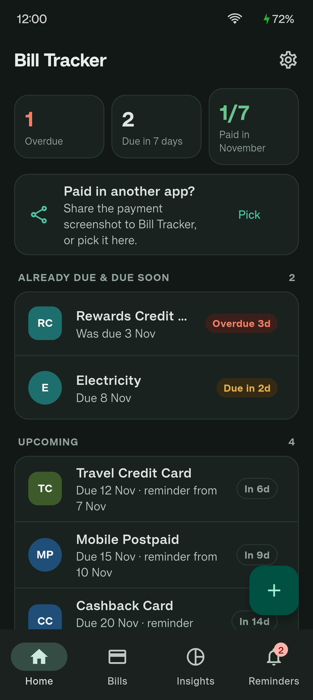
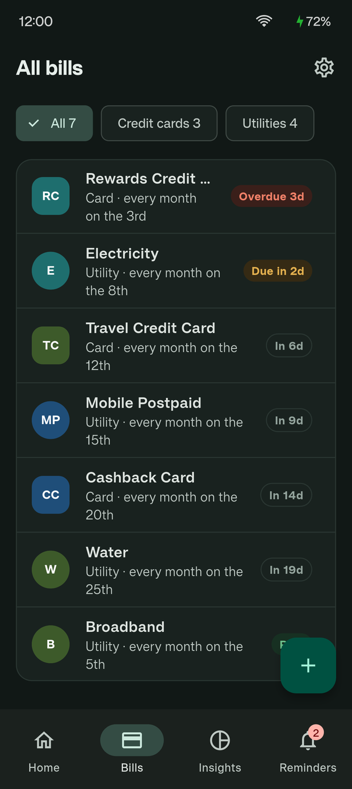
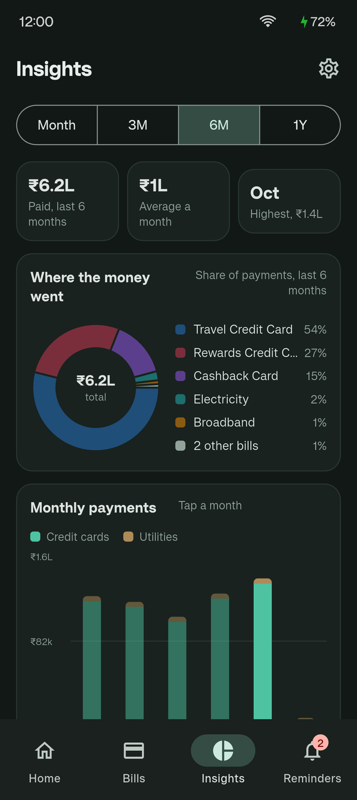
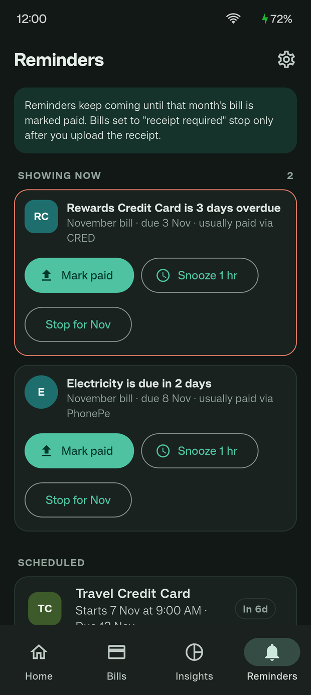
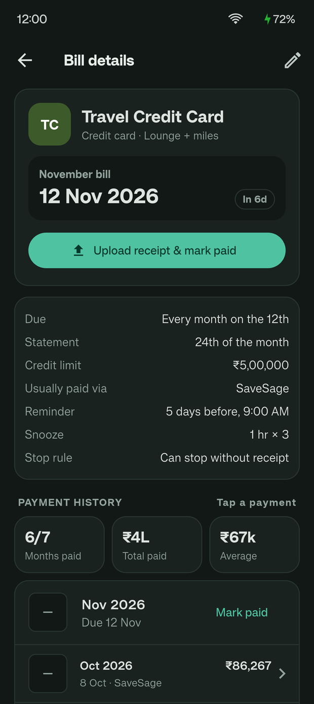
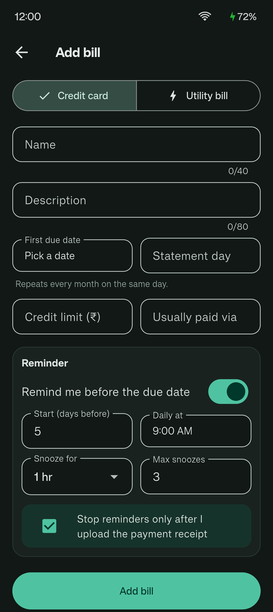

# Bill Tracker

A personal, offline Android app (Flutter) for tracking credit card and utility bills that you pay through different apps such as CRED, Paytm, PhonePe, Google Pay or your bank app.

Each payment app only knows about the payments made inside it. Bill Tracker gives you one place to see what is due, what is paid, and where the proof is. It has no server, no account and no network use. All data stays on your phone.

<p align="center">
  
  
  
</p>
<p align="center">
  
  
  
</p>

<sub>Screenshots use demo data.</sub>

## Features

- **All bills in one list.** Credit cards and utilities (electricity, broadband, mobile, water and so on), each with a monthly due date. Cards can also store a statement day and a credit limit.
- **Reminders until you pay.** Daily reminders start N days before the due date and keep coming until that month is marked paid. Notifications have **Snooze** and **Mark paid** buttons, and you can enter the amount right in the notification.
- **Receipt-gated mode.** You can set a bill so that reminders stop only after you attach a payment screenshot or PDF as proof.
- **Share to Bill Tracker.** Share a payment screenshot or PDF from any app, pick the bill, and it is saved as that month's receipt.
- **Files you can see.** Receipts and statements are saved as normal files in the `BillTracker` folder on the phone, sorted by bill and month.
- **Payment history.** For each bill you can see the months paid, the total and average, and any late payments.
- **Insights.** Charts for the last 1, 3, 6 or 12 months: the total spent, each bill's share, monthly bars for cards and utilities, card use against the 30% mark, and totals for each payment app.
- **Home-screen widgets.** One shows the next 3 bills. The other shows how many bills are due this week and how many are overdue.
- **App lock.** A 4-digit PIN with fingerprint unlock.
- **Backup and export.** Make a zip backup by hand or on a daily, weekly or monthly schedule, export to CSV, and restore from a backup. You can share a backup to Google Drive.

## Setup on Ubuntu 24.04

```bash
# 1. Basic tools and Java 17
sudo apt update
sudo apt install -y git curl unzip xz-utils zip libglu1-mesa openjdk-17-jdk python3

# 2. Flutter
sudo snap install flutter --classic
flutter --version          # first run downloads the SDK

# 3. Android SDK (via Android Studio, simplest)
sudo snap install android-studio --classic
android-studio             # finish the setup wizard (Standard install)
# In Android Studio: Settings > Languages & Frameworks > Android SDK > SDK Tools
#   tick "Android SDK Command-line Tools (latest)" and click Apply.
flutter doctor --android-licenses   # type y for each
flutter doctor                       # Android toolchain should show a tick

# 4. Project
git clone https://github.com/Chopra-Deven/Bill-Tracker.git
cd Bill-Tracker
chmod +x setup.sh
./setup.sh
```

## Run on your phone

1. On the phone: Settings > About phone > tap "Build number" 7 times. Then Settings > System > Developer options > turn on "USB debugging".
2. Connect with a USB cable and allow the prompt on the phone.
3. `flutter devices` should list the phone.
4. `flutter run` installs a debug build and shows live logs.

## Build an APK to install

```bash
flutter build apk --release
```

The file is `build/app/outputs/flutter-apk/app-release.apk`. Install with `adb install -r <apk>`, or copy it to the phone and open it (allow "Install unknown apps" for your file manager).

## After install, allow on the phone

- Notifications, and "Alarms & reminders" if asked (for on-time reminders).
- Settings > Storage > "Allow all files access" in the app, so files go to the BillTracker folder in main storage.
- Battery: set Bill Tracker to "Unrestricted" so reminders are not delayed. A daily background job re-plans reminders, refreshes the widgets and runs the auto-backup even when the app is not opened; battery restrictions can stop it.

## Google sign-in

The app requires Google sign-in and syncs to the user's own Drive. One-time setup and the build flag are in [docs/GOOGLE_SIGN_IN_SETUP.md](docs/GOOGLE_SIGN_IN_SETUP.md):

```bash
flutter run --dart-define=GOOGLE_SERVER_CLIENT_ID=<web client id>
```

## Project layout

- `lib/models.dart`, `lib/logic.dart` – data and monthly cycle rules (unit tested in `test/`)
- `lib/store.dart` – JSON storage and file copies
- `lib/notifications.dart` – reminders and notification buttons
- `lib/widget_sync.dart` – home-screen widgets
- `lib/backup.dart` – zip backup, CSV export, restore
- `lib/sync/` – Google sign-in, Drive sync engine and REST client (unit tested with a fake Drive)
- `lib/ui/` – screens
- `android_overlay/` – manifest, MainActivity, widget providers (copied by setup.sh)

See [APP_ANALYSIS.md](APP_ANALYSIS.md) for a detailed walkthrough of every feature and how data moves through the app.
